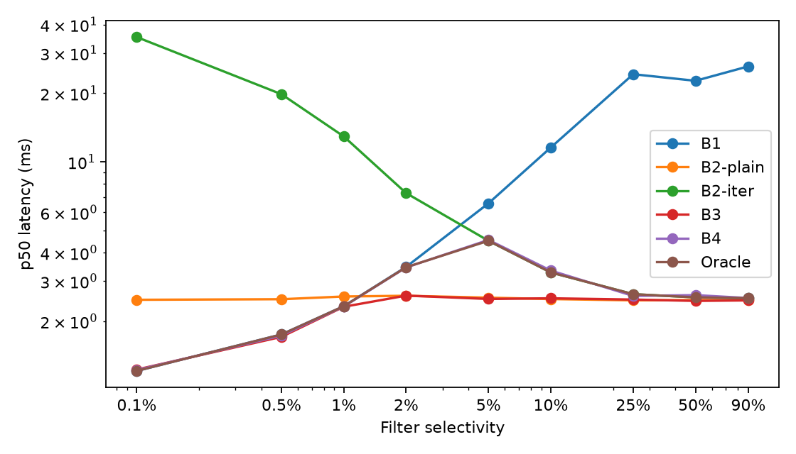
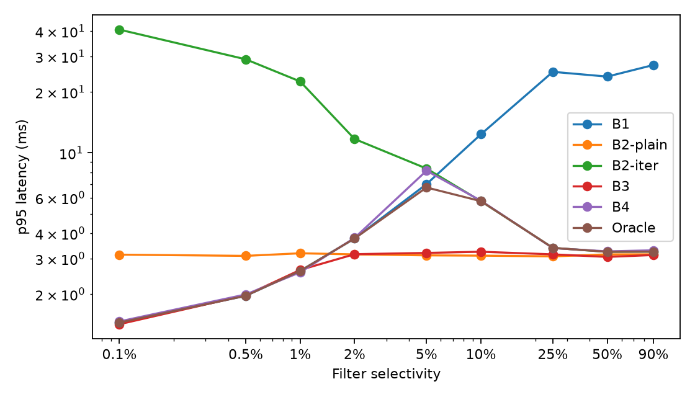
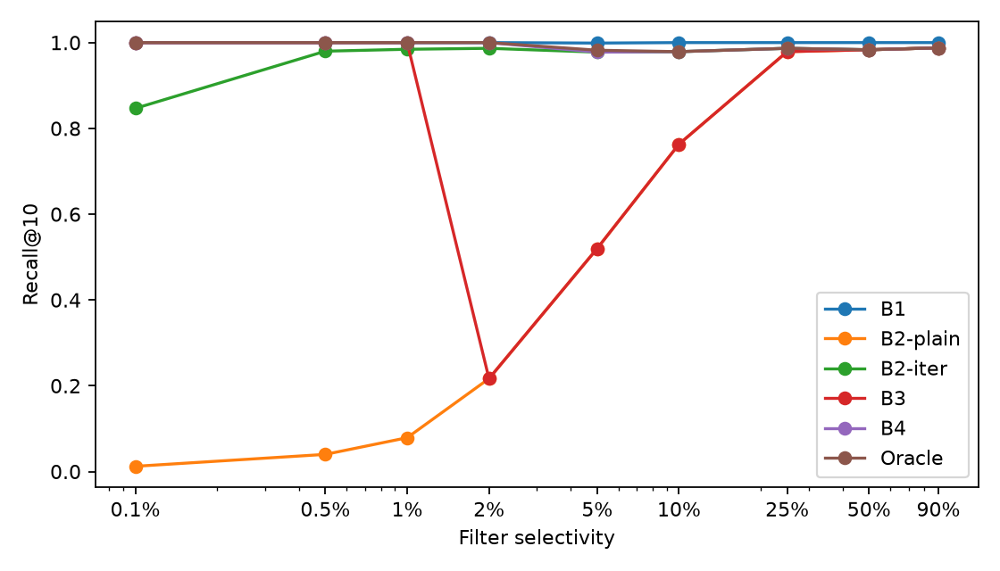
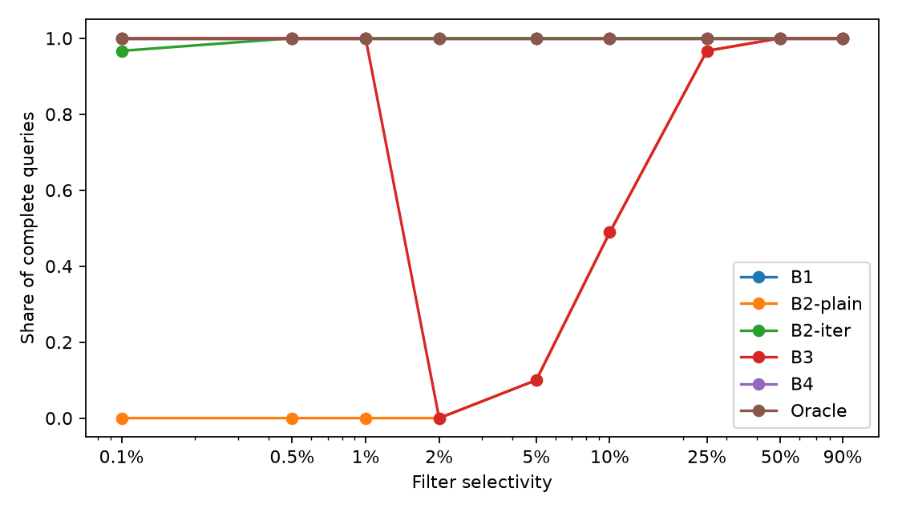
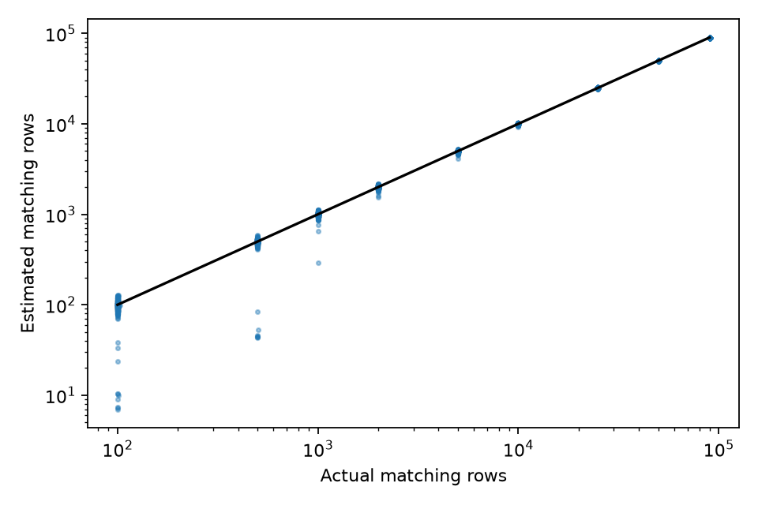
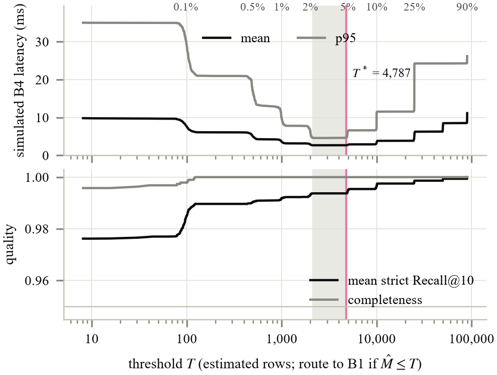

# Proposal experiment: full-20261125-203931

Source: `full-20261125-203931` (new experiment). B4 is named P1 in historical measurements.

Frozen threshold: **4,787.3 estimated rows**.

Latency includes execute/fetch and B4 routing overhead. Each query configuration uses the median of its timed repetitions. Oracle chooses the faster measured B1/B2-iter result without a quality constraint.

## Held-out results

| method | n_configs | p50_ms | p95_ms | mean_ms | recall | completeness | meets_quality | n_errors |
|---|---|---|---|---|---|---|---|---|
| B1 | 810 | 6.579 | 26.281 | 11.169 | 1.000 | 1.000 | True | 0 |
| B2-plain | 810 | 2.517 | 3.130 | 2.500 | 0.509 | 0.395 | False | 0 |
| B2-iter | 810 | 4.569 | 35.489 | 10.323 | 0.968 | 0.996 | True | 0 |
| B3 | 810 | 2.317 | 3.096 | 2.251 | 0.828 | 0.728 | False | 0 |
| B4 | 810 | 2.500 | 5.327 | 2.772 | 0.990 | 1.000 | True | 0 |
| Oracle | 810 | 2.504 | 5.317 | 2.734 | 0.991 | 1.000 | True | 0 |

## Success criteria

| scope | criterion | result | detail |
|---|---|---|---|
| overall | quality | PASS | Recall@10=0.9905; completeness=1.0000 |
| overall | p50_ms | PASS | B4 2.500 ms vs B2-iter 4.569 ms |
| overall | oracle gain (p50_ms) | 100.2% |  |
| overall | p95_ms | PASS | B4 5.327 ms vs B1 26.281 ms |
| overall | oracle gain (p95_ms) | 99.9% |  |
| overall | oracle gain (mean_ms) | 99.5% |  |
| 0.1% | quality | PASS | Recall@10=1.0000; completeness=1.0000 |
| 0.1% | p50_ms | FAIL | B4 1.220 ms vs B1 1.210 ms |
| 0.1% | oracle gain (p50_ms) | N/A | no headroom: oracle not faster than the best baseline |
| 0.1% | p95_ms | FAIL | B4 1.466 ms vs B3 1.420 ms |
| 0.1% | oracle gain (p95_ms) | N/A | no headroom: oracle not faster than the best baseline |
| 0.1% | oracle gain (mean_ms) | N/A | no headroom: oracle not faster than the best baseline |
| 0.5% | quality | PASS | Recall@10=1.0000; completeness=1.0000 |
| 0.5% | p50_ms | FAIL | B4 1.730 ms vs B3 1.707 ms |
| 0.5% | oracle gain (p50_ms) | N/A | no headroom: oracle not faster than the best baseline |
| 0.5% | p95_ms | FAIL | B4 1.993 ms vs B1 1.962 ms |
| 0.5% | oracle gain (p95_ms) | N/A | no headroom: oracle not faster than the best baseline |
| 0.5% | oracle gain (mean_ms) | N/A | no headroom: oracle not faster than the best baseline |
| 1% | quality | PASS | Recall@10=1.0000; completeness=1.0000 |
| 1% | p50_ms | FAIL | B4 2.321 ms vs B3 2.314 ms |
| 1% | oracle gain (p50_ms) | N/A | no headroom: oracle not faster than the best baseline |
| 1% | p95_ms | PASS | B4 2.565 ms vs B1 2.606 ms |
| 1% | oracle gain (p95_ms) | N/A | no headroom: oracle not faster than the best baseline |
| 1% | oracle gain (mean_ms) | N/A | no headroom: oracle not faster than the best baseline |
| 2% | quality | PASS | Recall@10=1.0000; completeness=1.0000 |
| 2% | p50_ms | PASS | B4 3.442 ms vs B1 3.460 ms |
| 2% | oracle gain (p50_ms) | N/A | headroom 10.6 us < 1% of best: ratio not meaningful |
| 2% | p95_ms | FAIL | B4 3.796 ms vs B1 3.770 ms |
| 2% | oracle gain (p95_ms) | N/A | no headroom: oracle not faster than the best baseline |
| 2% | oracle gain (mean_ms) | N/A | headroom 9.6 us < 1% of best: ratio not meaningful |
| 5% | quality | PASS | Recall@10=0.9778; completeness=1.0000 |
| 5% | p50_ms | FAIL | B4 4.543 ms vs B2-iter 4.505 ms |
| 5% | oracle gain (p50_ms) | N/A | no headroom: oracle not faster than the best baseline |
| 5% | p95_ms | FAIL | B4 8.161 ms vs B1 7.003 ms |
| 5% | oracle gain (p95_ms) | -442.3% |  |
| 5% | oracle gain (mean_ms) | 0.1% |  |
| 10% | quality | PASS | Recall@10=0.9789; completeness=1.0000 |
| 10% | p50_ms | FAIL | B4 3.334 ms vs B2-iter 3.272 ms |
| 10% | oracle gain (p50_ms) | N/A | no headroom: oracle not faster than the best baseline |
| 10% | p95_ms | FAIL | B4 5.796 ms vs B2-iter 5.768 ms |
| 10% | oracle gain (p95_ms) | N/A | no headroom: oracle not faster than the best baseline |
| 10% | oracle gain (mean_ms) | N/A | headroom 0.0 us < 1% of best: ratio not meaningful |
| 25% | quality | PASS | Recall@10=0.9867; completeness=1.0000 |
| 25% | p50_ms | PASS | B4 2.581 ms vs B2-iter 2.627 ms |
| 25% | oracle gain (p50_ms) | N/A | no headroom: oracle not faster than the best baseline |
| 25% | p95_ms | PASS | B4 3.380 ms vs B2-iter 3.388 ms |
| 25% | oracle gain (p95_ms) | N/A | no headroom: oracle not faster than the best baseline |
| 25% | oracle gain (mean_ms) | N/A | no headroom: oracle not faster than the best baseline |
| 50% | quality | PASS | Recall@10=0.9833; completeness=1.0000 |
| 50% | p50_ms | FAIL | B4 2.602 ms vs B3 2.454 ms |
| 50% | oracle gain (p50_ms) | N/A | no headroom: oracle not faster than the best baseline |
| 50% | p95_ms | FAIL | B4 3.257 ms vs B3 3.057 ms |
| 50% | oracle gain (p95_ms) | N/A | no headroom: oracle not faster than the best baseline |
| 50% | oracle gain (mean_ms) | N/A | no headroom: oracle not faster than the best baseline |
| 90% | quality | PASS | Recall@10=0.9878; completeness=1.0000 |
| 90% | p50_ms | FAIL | B4 2.526 ms vs B3 2.467 ms |
| 90% | oracle gain (p50_ms) | N/A | no headroom: oracle not faster than the best baseline |
| 90% | p95_ms | FAIL | B4 3.295 ms vs B3 3.122 ms |
| 90% | oracle gain (p95_ms) | N/A | no headroom: oracle not faster than the best baseline |
| 90% | oracle gain (mean_ms) | N/A | no headroom: oracle not faster than the best baseline |

## Results per selectivity

| method | target_sel | p50_ms | p95_ms | mean_ms | recall | completeness |
|---|---|---|---|---|---|---|
| B1 | 0.001 | 1.210 | 1.447 | 1.233 | 1.000 | 1.000 |
| B1 | 0.005 | 1.749 | 1.962 | 1.758 | 1.000 | 1.000 |
| B1 | 0.010 | 2.326 | 2.606 | 2.347 | 1.000 | 1.000 |
| B1 | 0.020 | 3.460 | 3.770 | 3.474 | 1.000 | 1.000 |
| B1 | 0.050 | 6.579 | 7.003 | 6.619 | 0.999 | 1.000 |
| B1 | 0.100 | 11.560 | 12.357 | 11.616 | 1.000 | 1.000 |
| B1 | 0.250 | 24.235 | 25.178 | 24.349 | 1.000 | 1.000 |
| B1 | 0.500 | 22.676 | 23.845 | 22.811 | 1.000 | 1.000 |
| B1 | 0.900 | 26.239 | 27.213 | 26.314 | 1.000 | 1.000 |
| B2-iter | 0.001 | 35.256 | 40.727 | 35.035 | 0.847 | 0.967 |
| B2-iter | 0.005 | 19.801 | 29.040 | 20.318 | 0.980 | 1.000 |
| B2-iter | 0.010 | 12.921 | 22.560 | 13.737 | 0.984 | 1.000 |
| B2-iter | 0.020 | 7.294 | 11.713 | 7.680 | 0.987 | 1.000 |
| B2-iter | 0.050 | 4.505 | 8.365 | 4.873 | 0.978 | 1.000 |
| B2-iter | 0.100 | 3.272 | 5.768 | 3.544 | 0.979 | 1.000 |
| B2-iter | 0.250 | 2.627 | 3.388 | 2.617 | 0.987 | 1.000 |
| B2-iter | 0.500 | 2.543 | 3.239 | 2.560 | 0.983 | 1.000 |
| B2-iter | 0.900 | 2.524 | 3.245 | 2.542 | 0.988 | 1.000 |
| B2-plain | 0.001 | 2.482 | 3.136 | 2.508 | 0.012 | 0.000 |
| B2-plain | 0.005 | 2.497 | 3.093 | 2.514 | 0.040 | 0.000 |
| B2-plain | 0.010 | 2.566 | 3.185 | 2.536 | 0.079 | 0.000 |
| B2-plain | 0.020 | 2.585 | 3.146 | 2.546 | 0.217 | 0.000 |
| B2-plain | 0.050 | 2.536 | 3.111 | 2.510 | 0.520 | 0.100 |
| B2-plain | 0.100 | 2.500 | 3.101 | 2.499 | 0.763 | 0.489 |
| B2-plain | 0.250 | 2.469 | 3.076 | 2.463 | 0.979 | 0.967 |
| B2-plain | 0.500 | 2.476 | 3.145 | 2.475 | 0.983 | 1.000 |
| B2-plain | 0.900 | 2.474 | 3.147 | 2.453 | 0.988 | 1.000 |
| B3 | 0.001 | 1.227 | 1.420 | 1.231 | 1.000 | 1.000 |
| B3 | 0.005 | 1.707 | 1.973 | 1.735 | 1.000 | 1.000 |
| B3 | 0.010 | 2.314 | 2.635 | 2.344 | 1.000 | 1.000 |
| B3 | 0.020 | 2.589 | 3.152 | 2.511 | 0.217 | 0.000 |
| B3 | 0.050 | 2.503 | 3.199 | 2.529 | 0.520 | 0.100 |
| B3 | 0.100 | 2.520 | 3.242 | 2.522 | 0.763 | 0.489 |
| B3 | 0.250 | 2.488 | 3.146 | 2.491 | 0.979 | 0.967 |
| B3 | 0.500 | 2.454 | 3.057 | 2.427 | 0.983 | 1.000 |
| B3 | 0.900 | 2.467 | 3.122 | 2.473 | 0.988 | 1.000 |
| B4 | 0.001 | 1.220 | 1.466 | 1.240 | 1.000 | 1.000 |
| B4 | 0.005 | 1.730 | 1.993 | 1.748 | 1.000 | 1.000 |
| B4 | 0.010 | 2.321 | 2.565 | 2.336 | 1.000 | 1.000 |
| B4 | 0.020 | 3.442 | 3.796 | 3.473 | 1.000 | 1.000 |
| B4 | 0.050 | 4.543 | 8.161 | 4.872 | 0.978 | 1.000 |
| B4 | 0.100 | 3.334 | 5.796 | 3.554 | 0.979 | 1.000 |
| B4 | 0.250 | 2.581 | 3.380 | 2.623 | 0.987 | 1.000 |
| B4 | 0.500 | 2.602 | 3.257 | 2.550 | 0.983 | 1.000 |
| B4 | 0.900 | 2.526 | 3.295 | 2.555 | 0.988 | 1.000 |
| Oracle | 0.001 | 1.210 | 1.447 | 1.233 | 1.000 | 1.000 |
| Oracle | 0.005 | 1.749 | 1.962 | 1.758 | 1.000 | 1.000 |
| Oracle | 0.010 | 2.326 | 2.606 | 2.347 | 1.000 | 1.000 |
| Oracle | 0.020 | 3.449 | 3.770 | 3.465 | 1.000 | 1.000 |
| Oracle | 0.050 | 4.505 | 6.741 | 4.543 | 0.982 | 1.000 |
| Oracle | 0.100 | 3.272 | 5.768 | 3.544 | 0.979 | 1.000 |
| Oracle | 0.250 | 2.627 | 3.388 | 2.617 | 0.987 | 1.000 |
| Oracle | 0.500 | 2.543 | 3.239 | 2.560 | 0.983 | 1.000 |
| Oracle | 0.900 | 2.524 | 3.245 | 2.542 | 0.988 | 1.000 |

## Row-estimate error

| target_sel | actual_median | estimate_median | mean_absolute_error | mean_absolute_relative_error |
|---|---|---|---|---|
| 0.001 | 100.000 | 97.679 | 11.040 | 0.110 |
| 0.005 | 500.000 | 494.769 | 31.005 | 0.062 |
| 0.010 | 1000.000 | 997.764 | 39.110 | 0.039 |
| 0.020 | 2000.000 | 2000.012 | 51.661 | 0.026 |
| 0.050 | 5000.000 | 4988.023 | 86.820 | 0.017 |
| 0.100 | 10000.000 | 9998.384 | 93.639 | 0.009 |
| 0.250 | 25000.000 | 24978.023 | 134.341 | 0.005 |
| 0.500 | 50000.000 | 49927.850 | 151.810 | 0.003 |
| 0.900 | 90000.000 | 89775.446 | 247.197 | 0.003 |

FAIL entries are reported even when the overall result passes.

## Figures

Calibration split: mean and p95 simulated latency (top), strict Recall@10 and completeness (bottom). The pink line marks the frozen threshold; the shaded band contains feasible thresholds within 1% of the minimum mean latency.
