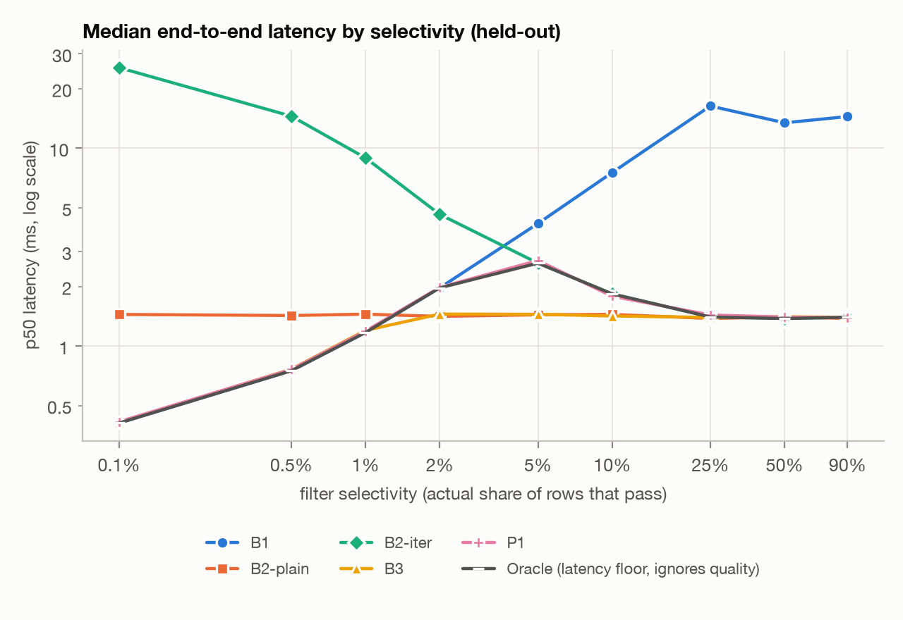
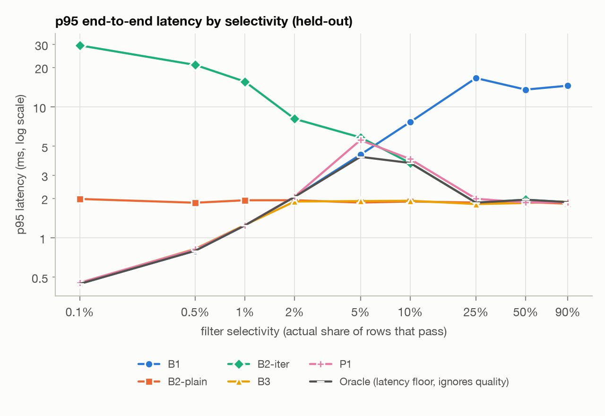
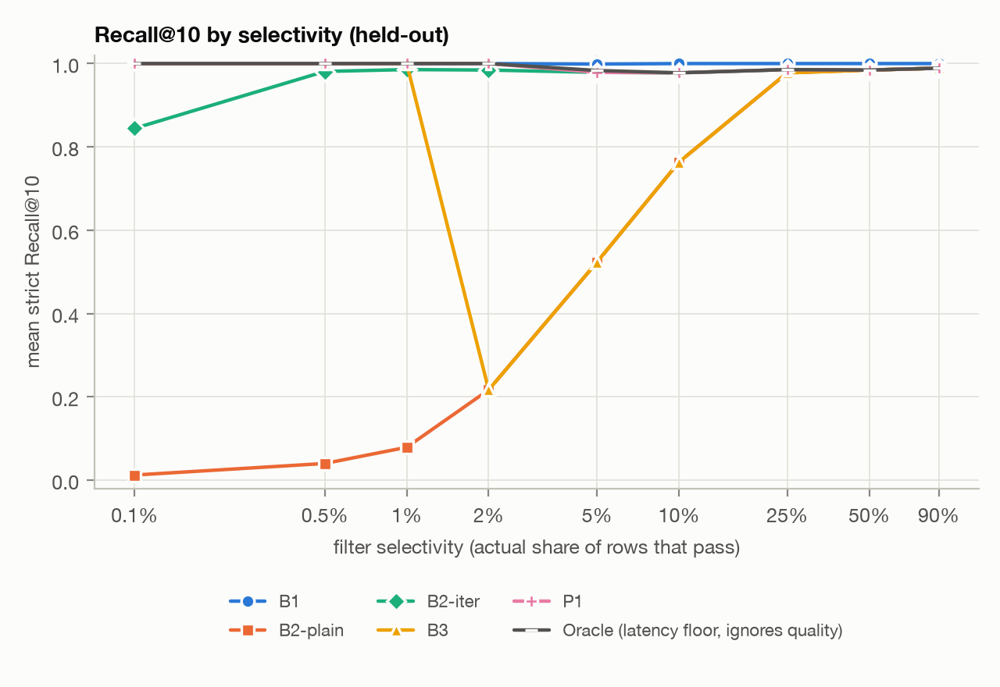
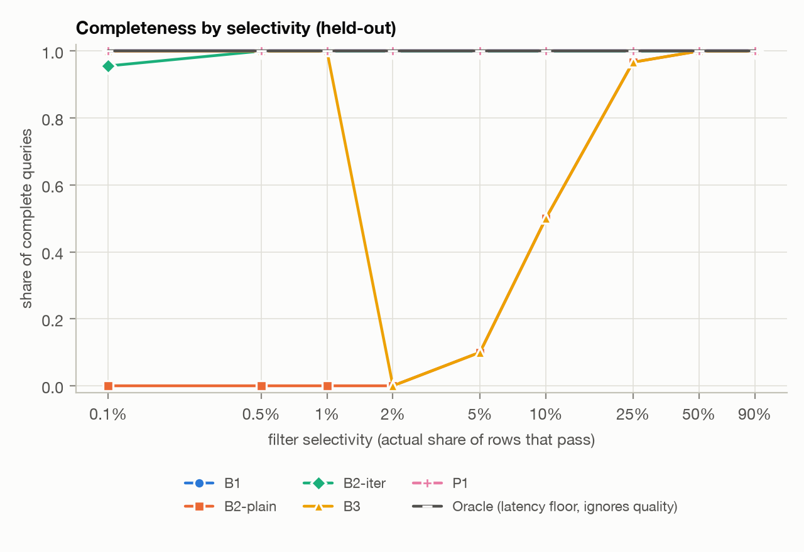
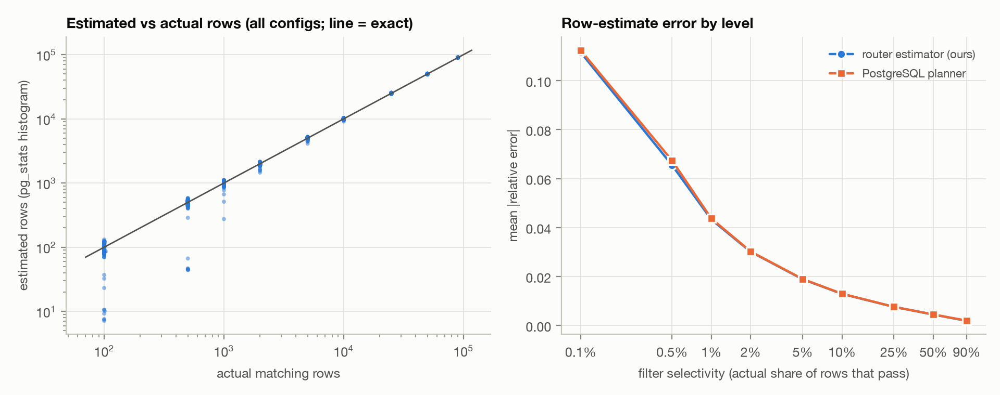
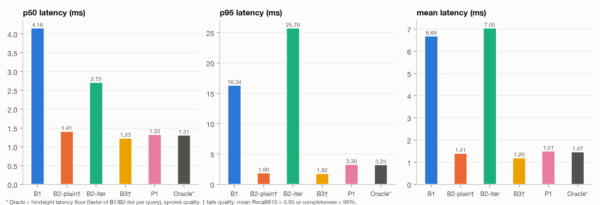
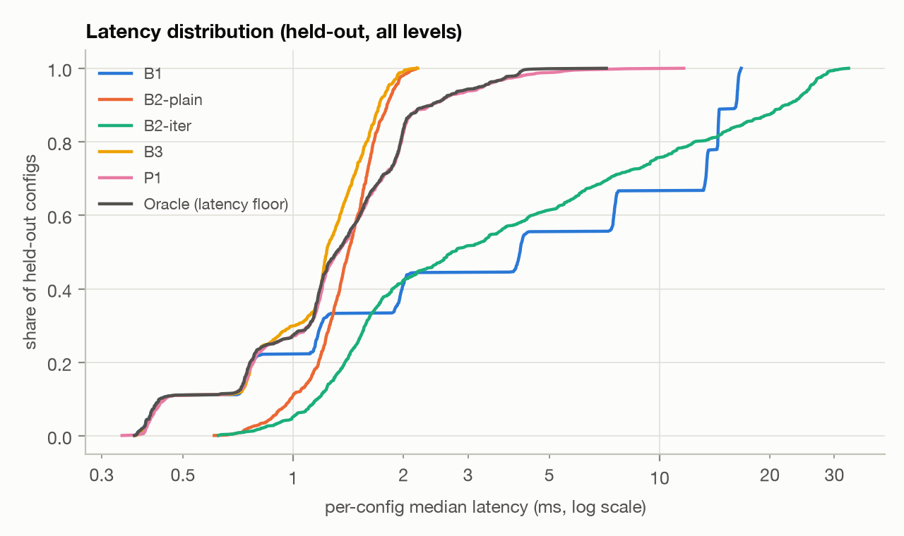
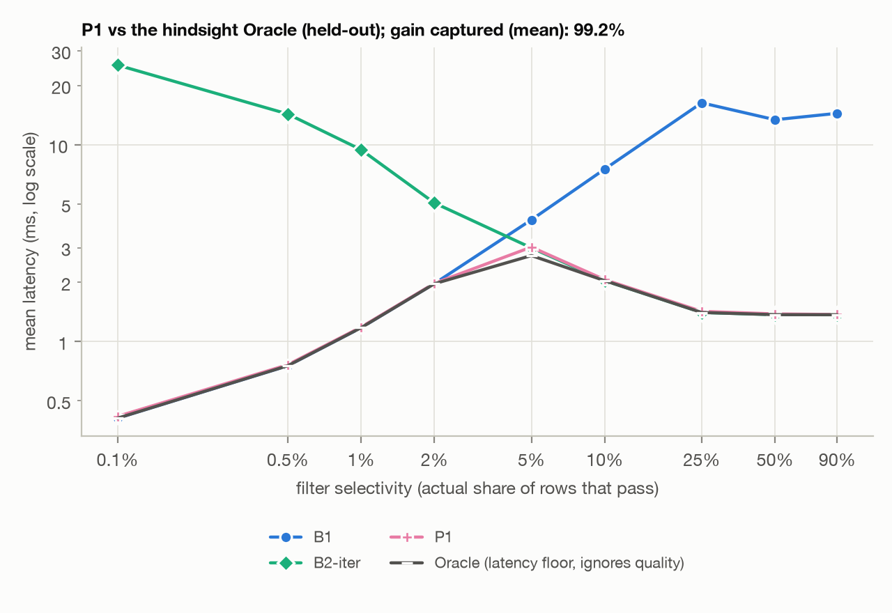
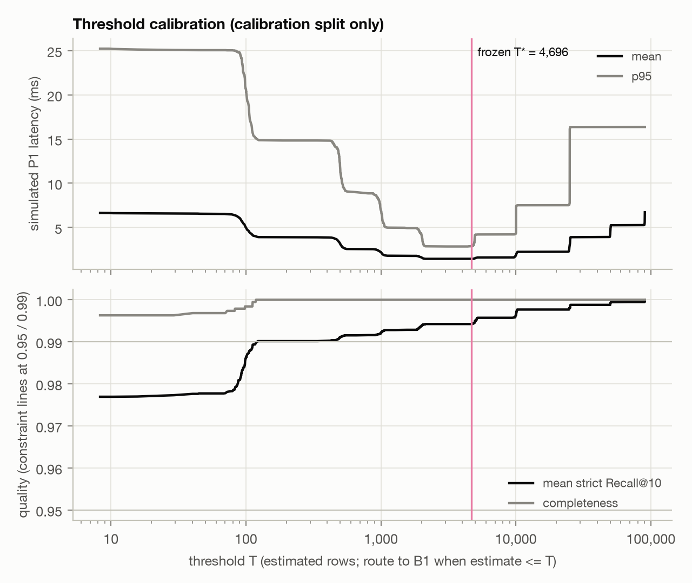
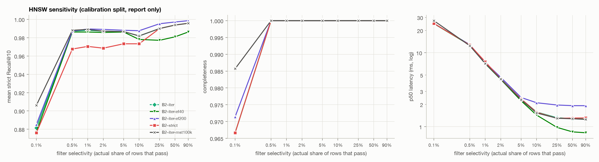

# Results: selectivity-aware query routing (run `full`)

All numbers below are generated from the measured data in this run directory. Latency is client-side end-to-end (includes network round trip and, for P1, routing overhead); per-config latency is the median of 5 timed repetitions; p50/p95/mean are taken over configs. Recall@10 is **strict ID overlap** with the exact top-k; tie-tolerant recall is a diagnostic only.

## Success criteria (held-out test split)

| criterion | detail | result |
|---|---|---|
| 1 quality | recall 0.9906 (>= 0.95), completeness 1.0000 (>= 0.99) | PASS |
| 2 p50_ms | P1 1.332 vs best qualifying baseline B2-iter 2.716 ms | PASS |
| 2 p95_ms | P1 3.297 vs best qualifying baseline B1 16.344 ms | PASS |
| 3 gain captured (p50_ms) | best=B2-iter 2.716, P1 1.332, Oracle 1.313 ms | 98.7% |
| 3 gain captured (p95_ms) | best=B1 16.344, P1 3.297, Oracle 3.247 ms | 99.6% |
| 3 gain captured (mean_ms) | best=B1 6.688, P1 1.511, Oracle 1.469 ms | 99.2% |

Criterion 2 compares against the best single baseline among B1, B2-plain, B2-iter, B3 that meets criterion 1 (B3+iter is supplementary and excluded). Gain captured = (best - P1) / (best - Oracle) for one statistic at a time; the Oracle is the hindsight latency floor (faster of B1/B2-iter per query, no quality requirement), so it is an optimistic bound.

### Per selectivity level

| level | 1 quality | 2 p50_ms | 2 p95_ms | 3 gain captured (mean_ms) | 3 gain captured (p50_ms) | 3 gain captured (p95_ms) |
|---|---|---|---|---|---|---|
| 0.1% | PASS | FAIL | FAIL | N/A (no headroom: oracle not faster than the best baseline) | N/A (no headroom: oracle not faster than the best baseline) | N/A (no headroom: oracle not faster than the best baseline) |
| 0.5% | PASS | FAIL | FAIL | N/A (headroom 0.0 us < 1% of best: ratio not meaningful) | N/A (no headroom: oracle not faster than the best baseline) | N/A (no headroom: oracle not faster than the best baseline) |
| 1% | PASS | FAIL | PASS | N/A (no headroom: oracle not faster than the best baseline) | N/A (no headroom: oracle not faster than the best baseline) | N/A (no headroom: oracle not faster than the best baseline) |
| 2% | PASS | FAIL | FAIL | N/A (headroom 3.5 us < 1% of best: ratio not meaningful) | N/A (headroom 0.9 us < 1% of best: ratio not meaningful) | N/A (no headroom: oracle not faster than the best baseline) |
| 5% | PASS | FAIL | FAIL | -10.7% | N/A (no headroom: oracle not faster than the best baseline) | -790.7% |
| 10% | PASS | PASS | FAIL | N/A (no headroom: oracle not faster than the best baseline) | N/A (no headroom: oracle not faster than the best baseline) | N/A (no headroom: oracle not faster than the best baseline) |
| 25% | PASS | FAIL | FAIL | N/A (no headroom: oracle not faster than the best baseline) | N/A (no headroom: oracle not faster than the best baseline) | N/A (no headroom: oracle not faster than the best baseline) |
| 50% | PASS | FAIL | FAIL | N/A (no headroom: oracle not faster than the best baseline) | N/A (no headroom: oracle not faster than the best baseline) | N/A (no headroom: oracle not faster than the best baseline) |
| 90% | PASS | FAIL | FAIL | N/A (no headroom: oracle not faster than the best baseline) | N/A (no headroom: oracle not faster than the best baseline) | N/A (no headroom: oracle not faster than the best baseline) |

**Levels where P1 does not meet a criterion under the strict per-level rule (RQ3):** 0.1%, 0.5%, 1%, 2%, 5%, 10%, 25%, 50%, 90%.

Criterion 2 per level with effect sizes (P1 minus the best qualifying baseline *at that level*; 95% paired bootstrap CI over the level's configs). The pre-registered verdict is strict (P1 must be <= best); the CI shows whether a FAIL is distinguishable from measurement noise:

| level | stat | best_baseline | best_ms | p1_ms | diff_ms | diff_pct | ci_low | ci_high | verdict |
|---|---|---|---|---|---|---|---|---|---|
| 0.1% | p50_ms | B1 | 0.407 | 0.414 | 0.006 | 1.498 | -0.001 | 0.015 | FAIL (difference within bootstrap CI of 0) |
| 0.1% | p95_ms | B1 | 0.444 | 0.454 | 0.009 | 2.096 | -0.013 | 0.032 | FAIL (difference within bootstrap CI of 0) |
| 0.5% | p50_ms | B1 | 0.749 | 0.760 | 0.011 | 1.499 | 0.001 | 0.019 | FAIL (P1 slower; CI excludes 0) |
| 0.5% | p95_ms | B1 | 0.795 | 0.817 | 0.022 | 2.756 | -0.009 | 0.034 | FAIL (difference within bootstrap CI of 0) |
| 1% | p50_ms | B1 | 1.169 | 1.188 | 0.019 | 1.593 | 0.005 | 0.031 | FAIL (P1 slower; CI excludes 0) |
| 1% | p95_ms | B1 | 1.243 | 1.242 | -0.000 | -0.037 | -0.022 | 0.021 | PASS |
| 2% | p50_ms | B1 | 1.967 | 1.979 | 0.011 | 0.576 | -0.010 | 0.025 | FAIL (difference within bootstrap CI of 0) |
| 2% | p95_ms | B1 | 2.055 | 2.066 | 0.011 | 0.546 | -0.040 | 0.052 | FAIL (difference within bootstrap CI of 0) |
| 5% | p50_ms | B2-iter | 2.622 | 2.702 | 0.080 | 3.052 | -0.055 | 0.429 | FAIL (difference within bootstrap CI of 0) |
| 5% | p95_ms | B1 | 4.314 | 5.575 | 1.261 | 29.235 | 0.155 | 3.006 | FAIL (P1 slower; CI excludes 0) |
| 10% | p50_ms | B2-iter | 1.834 | 1.785 | -0.049 | -2.649 | -0.105 | 0.114 | PASS |
| 10% | p95_ms | B2-iter | 3.730 | 3.994 | 0.264 | 7.084 | -0.197 | 0.498 | FAIL (difference within bootstrap CI of 0) |
| 25% | p50_ms | B2-iter | 1.401 | 1.434 | 0.032 | 2.316 | -0.075 | 0.090 | FAIL (difference within bootstrap CI of 0) |
| 25% | p95_ms | B2-iter | 1.854 | 1.987 | 0.132 | 7.130 | -0.035 | 0.332 | FAIL (difference within bootstrap CI of 0) |
| 50% | p50_ms | B2-iter | 1.376 | 1.399 | 0.023 | 1.685 | -0.038 | 0.073 | FAIL (difference within bootstrap CI of 0) |
| 50% | p95_ms | B3 | 1.842 | 1.860 | 0.018 | 0.958 | -0.073 | 0.138 | FAIL (difference within bootstrap CI of 0) |
| 90% | p50_ms | B2-plain | 1.377 | 1.392 | 0.014 | 1.050 | -0.073 | 0.057 | FAIL (difference within bootstrap CI of 0) |
| 90% | p95_ms | B2-plain | 1.823 | 1.871 | 0.048 | 2.645 | -0.090 | 0.159 | FAIL (difference within bootstrap CI of 0) |

Statistically distinguishable per-level losses: 0.5% p50_ms vs B1, 1% p50_ms vs B1, 5% p95_ms vs B1.

## Held-out summary (all levels, each level weighted 1/9)

| method | role | n_configs | p50_ms | p95_ms | mean_ms | recall | recall_tol | completeness | meets_quality | n_errors |
|---|---|---|---|---|---|---|---|---|---|---|
| B1 | baseline | 810 | 4.159 | 16.344 | 6.688 | 1.000 | 1.000 | 1.000 | True | 0 |
| B2-plain | baseline | 810 | 1.414 | 1.901 | 1.411 | 0.510 | 0.510 | 0.396 | False | 0 |
| B2-iter | baseline | 810 | 2.716 | 25.758 | 7.049 | 0.968 | 0.968 | 0.995 | True | 0 |
| B3 | baseline | 810 | 1.233 | 1.818 | 1.204 | 0.828 | 0.828 | 0.730 | False | 0 |
| P1 | proposed | 810 | 1.332 | 3.297 | 1.511 | 0.991 | 0.991 | 1.000 | True | 0 |
| Oracle | reference (latency floor, ignores quality) | 810 | 1.313 | 3.247 | 1.469 | 0.991 | n/a | 1.000 | True | 0 |
| Oracle-V | supplementary | 810 | 1.335 | 7.464 | 2.092 | 1.000 | n/a | 1.000 | True | 0 |
| B3+iter | supplementary | 810 | 1.359 | 5.415 | 1.873 | 0.989 | 0.989 | 1.000 | True | 0 |

95% cluster-bootstrap CIs (resampling query vectors) for the proposed router and paired differences (negative = P1 faster / lower):

| method | mean_ms | p50_ms | p95_ms | recall |
|---|---|---|---|---|
| B1 | [6.682, 6.694] | [4.139, 4.174] | [16.304, 16.382] | [1.000, 1.000] |
| B2-iter | [6.857, 7.252] | [2.583, 3.054] | [25.263, 26.481] | [0.962, 0.974] |
| B2-plain | [1.352, 1.471] | [1.347, 1.488] | [1.812, 1.948] | [0.499, 0.520] |
| B3 | [1.163, 1.243] | [1.205, 1.298] | [1.732, 1.903] | [0.819, 0.838] |
| P1 | [1.456, 1.569] | [1.254, 1.417] | [2.956, 3.540] | [0.987, 0.994] |
| P1 - B1 | [-5.233, -5.118] | [-2.901, -2.742] | [-13.386, -12.806] | [-0.013, -0.006] |
| P1 - B2-iter | [-5.711, -5.376] | [-1.687, -1.265] | [-23.265, -21.918] | [0.019, 0.027] |
| P1 - B2-plain | [0.054, 0.148] | [-0.125, -0.052] | [1.071, 1.647] | [0.471, 0.492] |
| P1 - B3 | [0.268, 0.351] | [0.044, 0.145] | [1.149, 1.721] | [0.152, 0.172] |

### By level

**p50 latency (ms)**

| target_sel | B1 | B2-plain | B2-iter | B3 | P1 | Oracle |
|---|---|---|---|---|---|---|
| 0.1% | 0.407 | 1.443 | 25.539 | 0.410 | 0.414 | 0.407 |
| 0.5% | 0.749 | 1.425 | 14.517 | 0.763 | 0.760 | 0.749 |
| 1% | 1.169 | 1.448 | 8.925 | 1.199 | 1.188 | 1.169 |
| 2% | 1.967 | 1.411 | 4.623 | 1.449 | 1.979 | 1.966 |
| 5% | 4.159 | 1.438 | 2.622 | 1.446 | 2.702 | 2.622 |
| 10% | 7.525 | 1.444 | 1.834 | 1.417 | 1.785 | 1.834 |
| 25% | 16.336 | 1.376 | 1.401 | 1.395 | 1.434 | 1.401 |
| 50% | 13.428 | 1.402 | 1.376 | 1.404 | 1.399 | 1.376 |
| 90% | 14.453 | 1.377 | 1.397 | 1.396 | 1.392 | 1.397 |

**p95 latency (ms)**

| target_sel | B1 | B2-plain | B2-iter | B3 | P1 | Oracle |
|---|---|---|---|---|---|---|
| 0.1% | 0.444 | 1.980 | 29.531 | 0.450 | 0.454 | 0.444 |
| 0.5% | 0.795 | 1.852 | 20.940 | 0.823 | 0.817 | 0.795 |
| 1% | 1.243 | 1.934 | 15.605 | 1.253 | 1.242 | 1.243 |
| 2% | 2.055 | 1.936 | 8.102 | 1.892 | 2.066 | 2.055 |
| 5% | 4.314 | 1.858 | 5.847 | 1.907 | 5.575 | 4.154 |
| 10% | 7.659 | 1.893 | 3.730 | 1.918 | 3.994 | 3.730 |
| 25% | 16.611 | 1.857 | 1.854 | 1.811 | 1.987 | 1.854 |
| 50% | 13.559 | 1.872 | 1.954 | 1.842 | 1.860 | 1.954 |
| 90% | 14.530 | 1.823 | 1.873 | 1.895 | 1.871 | 1.873 |

**mean strict Recall@10**

| target_sel | B1 | B2-plain | B2-iter | B3 | P1 | Oracle |
|---|---|---|---|---|---|---|
| 0.1% | 1.000 | 0.012 | 0.844 | 1.000 | 1.000 | 1.000 |
| 0.5% | 1.000 | 0.040 | 0.981 | 1.000 | 1.000 | 1.000 |
| 1% | 1.000 | 0.079 | 0.986 | 1.000 | 1.000 | 1.000 |
| 2% | 1.000 | 0.217 | 0.984 | 0.217 | 1.000 | 1.000 |
| 5% | 0.999 | 0.523 | 0.979 | 0.523 | 0.979 | 0.983 |
| 10% | 1.000 | 0.763 | 0.978 | 0.763 | 0.978 | 0.978 |
| 25% | 1.000 | 0.978 | 0.986 | 0.978 | 0.986 | 0.986 |
| 50% | 1.000 | 0.984 | 0.984 | 0.984 | 0.984 | 0.984 |
| 90% | 1.000 | 0.989 | 0.989 | 0.989 | 0.989 | 0.989 |

**completeness**

| target_sel | B1 | B2-plain | B2-iter | B3 | P1 | Oracle |
|---|---|---|---|---|---|---|
| 0.1% | 1.000 | 0.000 | 0.956 | 1.000 | 1.000 | 1.000 |
| 0.5% | 1.000 | 0.000 | 1.000 | 1.000 | 1.000 | 1.000 |
| 1% | 1.000 | 0.000 | 1.000 | 1.000 | 1.000 | 1.000 |
| 2% | 1.000 | 0.000 | 1.000 | 0.000 | 1.000 | 1.000 |
| 5% | 1.000 | 0.100 | 1.000 | 0.100 | 1.000 | 1.000 |
| 10% | 1.000 | 0.500 | 1.000 | 0.500 | 1.000 | 1.000 |
| 25% | 1.000 | 0.967 | 1.000 | 0.967 | 1.000 | 1.000 |
| 50% | 1.000 | 1.000 | 1.000 | 1.000 | 1.000 | 1.000 |
| 90% | 1.000 | 1.000 | 1.000 | 1.000 | 1.000 | 1.000 |

## Routing behaviour vs the hindsight Oracle

| target_sel | n | p1_to_B1 | oracle_to_B1 | agreement | mean_cost_vs_oracle_ms | median_est_rows | median_actual_rows |
|---|---|---|---|---|---|---|---|
| 0.1% | 90 | 90 | 90 | 1.000 | 0.009 | 98.012 | 100.000 |
| 0.5% | 90 | 90 | 90 | 1.000 | 0.009 | 496.598 | 500.000 |
| 1% | 90 | 90 | 90 | 1.000 | 0.009 | 1007.002 | 1000.000 |
| 2% | 90 | 90 | 89 | 0.989 | 0.010 | 2000.043 | 2000.000 |
| 5% | 90 | 1 | 13 | 0.844 | 0.285 | 4995.443 | 5000.000 |
| 10% | 90 | 0 | 0 | 1.000 | 0.024 | 10056.157 | 10000.000 |
| 25% | 90 | 0 | 0 | 1.000 | 0.019 | 25054.635 | 25000.000 |
| 50% | 90 | 0 | 0 | 1.000 | 0.012 | 50123.742 | 50000.000 |
| 90% | 90 | 0 | 0 | 1.000 | 0.004 | 90139.566 | 90000.000 |

P1 routing overhead measured live inside the benchmark loop (estimate + decision, in-process): median 9.6 µs, p95 14.9 µs. Calibration used a tight-loop measurement of 0.6 µs; the live value is higher because the router code runs cold between database round trips. P1 minus its chosen arm's latency in the same session: median 8.4 µs, i.e. the live cost of routing is about 8 µs per query - small against millisecond latencies, but visible at the most selective levels where both P1 and B1 run the same exact plan in < 1.2 ms.

## Selectivity estimation (all 2,700 configs)

| target_sel | actual_median | est_ours_median | est_pg_median | mean_abs_rel_err_ours | p95_abs_rel_err_ours | mean_abs_rel_err_pg | mean_abs_err_ours_rows |
|---|---|---|---|---|---|---|---|
| 0.1% | 100.000 | 98.012 | 99.000 | 0.112 | 0.258 | 0.112 | 11.166 |
| 0.5% | 500.000 | 496.598 | 497.500 | 0.066 | 0.145 | 0.067 | 32.764 |
| 1% | 1000.000 | 1003.240 | 1004.500 | 0.043 | 0.107 | 0.044 | 43.274 |
| 2% | 2000.000 | 1997.923 | 1999.000 | 0.030 | 0.071 | 0.030 | 60.145 |
| 5% | 5000.000 | 4979.446 | 4980.500 | 0.019 | 0.042 | 0.019 | 94.313 |
| 10% | 10000.000 | 10050.011 | 10051.000 | 0.013 | 0.030 | 0.013 | 128.806 |
| 25% | 25000.000 | 25076.093 | 25077.000 | 0.008 | 0.015 | 0.008 | 188.915 |
| 50% | 50000.000 | 50120.482 | 50121.500 | 0.004 | 0.010 | 0.004 | 221.476 |
| 90% | 90000.000 | 90142.600 | 90144.000 | 0.002 | 0.004 | 0.002 | 167.601 |

Our estimator vs PostgreSQL's own planner estimate: median |relative difference| 0.0002, p95 0.0110.

## Calibration (calibration split only)

- Frozen threshold **T\* = 4,695.8 estimated rows** (p95-optimal feasible T would be 4,417.8); frozen at 2026-11-07T18:27:22+0800.
- HNSW: ef_search = 100, iterative_scan = relaxed_order, max_scan_tuples = 20000, m = 16, ef_construction = 64.
- Guard: B2-iter mean strict recall at the broadest level = 0.9957 (threshold 0.95) -> not triggered.
- Simulated P1 on calibration at T\*: mean 1.437 ms, p50 1.259, p95 2.876, recall 0.9942, completeness 1.0000, 44.7% routed to B1. 1888 candidate thresholds evaluated.
- Flatness of the objective: every feasible T in [2,129, 4,842] is within 1% of the best calibration mean latency, so T* is one point of a near-optimal interval (reported, not re-tuned).

Calibration-split summary of every variant (the four sensitivity variants are report-only):

| method | n_configs | p50_ms | p95_ms | mean_ms | recall | completeness |
|---|---|---|---|---|---|---|
| B1 | 1890 | 4.192 | 16.369 | 6.726 | 1.000 | 1.000 |
| B2-iter | 1890 | 2.447 | 25.221 | 6.652 | 0.977 | 0.996 |
| B2-iter-ef200 | 1890 | 2.832 | 25.351 | 6.995 | 0.980 | 0.997 |
| B2-iter-ef40 | 1890 | 2.323 | 25.183 | 6.447 | 0.972 | 0.996 |
| B2-iter-mst100k | 1890 | 2.447 | 27.910 | 6.944 | 0.980 | 0.998 |
| B2-plain | 1890 | 1.309 | 1.795 | 1.329 | 0.519 | 0.405 |
| B2-strict | 1890 | 2.485 | 25.220 | 6.670 | 0.968 | 0.996 |
| B3 | 1890 | 1.217 | 1.750 | 1.160 | 0.833 | 0.738 |

## Verification

- Ground-truth gate: reproducing Qdrant's exact `closest_ids` for the 300 selected queries under their original conditions - mean overlap 0.9987, exact match 99.0% (3 queries differ), tie-aware overlap 1.0000, max |score diff| 2.30e-07. Every differing id lies at exactly the same distance as one of ours (duplicate images); Qdrant breaks such exact ties differently from our (distance, id) rule.
- `ids`: PASS {'rows': 100000, 'distinct': 100000, 'min': 0, 'max': 99999}
- `filter_values_exact`: PASS {}
- `vectors_exact_sample`: PASS {'n': 1000}
- `cosine_consistency`: PASS {'max_abs_diff': 4.469753063229831e-07, 'tolerance': 1e-06}
- `predicate_equivalence`: PASS {'rows_where_x_plus_0_differs': 0, 'nonfinite_rows': 0}
- `eligible_counts`: PASS {'n_filters': 2700, 'mismatches': 0}
- `stats_snapshot_current`: PASS {}
- `estimator_matches_planner`: PASS {'median_abs_rel_diff': 0.0002364428207695555, 'p95_abs_rel_diff': 0.010972673236310602}
- `b1_equals_ground_truth`: PASS {'n_configs': 2700, 'strict_mismatches': 2, 'unexplained_mismatches': 0}

Plan audit (plain EXPLAIN on every config x method; EXPLAIN ANALYZE BUFFERS on a stratified sample):

| phase | plans_checked | violations | explain_analyze_samples | max_shared_read_blocks |
|---|---|---|---|---|
| calibration | 15120 | 0 | 180 | 0 |
| test | 4860 | 0 | 270 | 0 |

Plan choice by level (B1 = exact paths; B3 = PostgreSQL default planner decision under the shared HNSW configuration):

| phase | method | target_sel | btree_bitmap | btree_index | hnsw | seq |
|---|---|---|---|---|---|---|
| calibration | B1 | 0.1% | 210 | 0 | 0 | 0 |
| calibration | B1 | 0.5% | 210 | 0 | 0 | 0 |
| calibration | B1 | 1% | 210 | 0 | 0 | 0 |
| calibration | B1 | 2% | 210 | 0 | 0 | 0 |
| calibration | B1 | 5% | 210 | 0 | 0 | 0 |
| calibration | B1 | 10% | 210 | 0 | 0 | 0 |
| calibration | B1 | 25% | 210 | 0 | 0 | 0 |
| calibration | B1 | 50% | 0 | 0 | 0 | 210 |
| calibration | B1 | 90% | 0 | 0 | 0 | 210 |
| calibration | B3 | 0.1% | 206 | 4 | 0 | 0 |
| calibration | B3 | 0.5% | 206 | 4 | 0 | 0 |
| calibration | B3 | 1% | 210 | 0 | 0 | 0 |
| calibration | B3 | 2% | 0 | 0 | 210 | 0 |
| calibration | B3 | 5% | 0 | 0 | 210 | 0 |
| calibration | B3 | 10% | 0 | 0 | 210 | 0 |
| calibration | B3 | 25% | 0 | 0 | 210 | 0 |
| calibration | B3 | 50% | 0 | 0 | 210 | 0 |
| calibration | B3 | 90% | 0 | 0 | 210 | 0 |
| test | B1 | 0.1% | 90 | 0 | 0 | 0 |
| test | B1 | 0.5% | 90 | 0 | 0 | 0 |
| test | B1 | 1% | 90 | 0 | 0 | 0 |
| test | B1 | 2% | 90 | 0 | 0 | 0 |
| test | B1 | 5% | 90 | 0 | 0 | 0 |
| test | B1 | 10% | 90 | 0 | 0 | 0 |
| test | B1 | 25% | 90 | 0 | 0 | 0 |
| test | B1 | 50% | 0 | 0 | 0 | 90 |
| test | B1 | 90% | 0 | 0 | 0 | 90 |
| test | B3 | 0.1% | 87 | 3 | 0 | 0 |
| test | B3 | 0.5% | 88 | 2 | 0 | 0 |
| test | B3 | 1% | 90 | 0 | 0 | 0 |
| test | B3 | 2% | 0 | 0 | 90 | 0 |
| test | B3 | 5% | 0 | 0 | 90 | 0 |
| test | B3 | 10% | 0 | 0 | 90 | 0 |
| test | B3 | 25% | 0 | 0 | 90 | 0 |
| test | B3 | 50% | 0 | 0 | 90 | 0 |
| test | B3 | 90% | 0 | 0 | 90 | 0 |
| test | B3+iter | 0.1% | 87 | 3 | 0 | 0 |
| test | B3+iter | 0.5% | 88 | 2 | 0 | 0 |
| test | B3+iter | 1% | 90 | 0 | 0 | 0 |
| test | B3+iter | 2% | 0 | 0 | 90 | 0 |
| test | B3+iter | 5% | 0 | 0 | 90 | 0 |
| test | B3+iter | 10% | 0 | 0 | 90 | 0 |
| test | B3+iter | 25% | 0 | 0 | 90 | 0 |
| test | B3+iter | 50% | 0 | 0 | 90 | 0 |
| test | B3+iter | 90% | 0 | 0 | 90 | 0 |

## Environment and runtime

- PostgreSQL 17.11 (Debian 17.11-1.pgdg12+2) on aarch64-unknown-linux-gnu, compiled by gcc (Debian 12.2.0-14+deb12u1) 12.2.0, 64-bit; pgvector 0.8.7.
- Host: Apple M4, 10 cores; Docker 29.2.1 (cpus=10 mem=8217059328); Python 3.12.10.
- Table: 100,000 rows; heap 260 MB (TOAST 0 B), B-tree 2.2 MB, HNSW 260 MB; HNSW build 10.4 s; load 1.5 s.
- Key settings: shared_buffers=2GB, work_mem=4MB, jit=off, max_parallel_workers_per_gather=2, random_page_cost=4, default_statistics_target=100.
- calibration: 1890 configs x 8 methods, 75,600 timed executions, 0 errors, wall clock 8.4 min; `SELECT 1` RTT p50 0.160 ms.
- test: 810 configs x 6 methods, 24,300 timed executions, 0 errors, wall clock 1.7 min; `SELECT 1` RTT p50 0.184 ms.

Per-pass median latency (held-out; drift check):

| method | 0 | 1 | 2 | 3 | 4 |
|---|---|---|---|---|---|
| B1 | 4.082 | 4.118 | 4.187 | 4.203 | 4.176 |
| B2-iter | 2.800 | 2.785 | 2.765 | 2.793 | 2.882 |
| B2-plain | 1.447 | 1.414 | 1.433 | 1.428 | 1.422 |
| B3 | 1.230 | 1.232 | 1.250 | 1.257 | 1.257 |
| B3+iter | 1.370 | 1.364 | 1.369 | 1.376 | 1.350 |
| P1 | 1.325 | 1.324 | 1.324 | 1.370 | 1.342 |

## Figures

